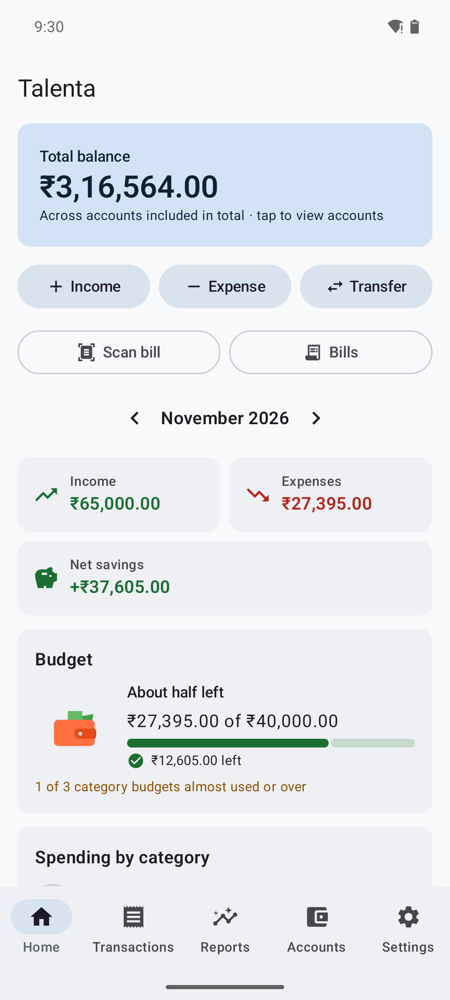
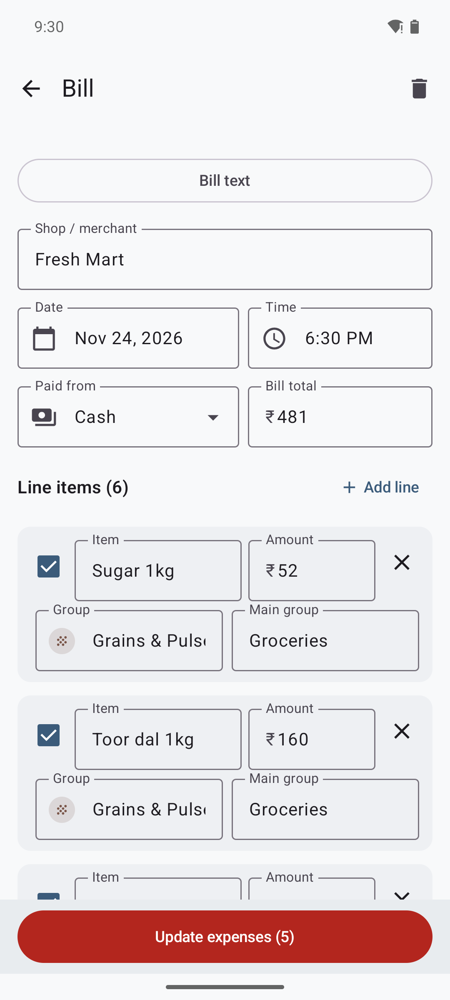
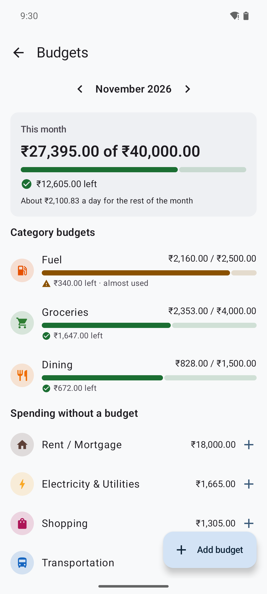
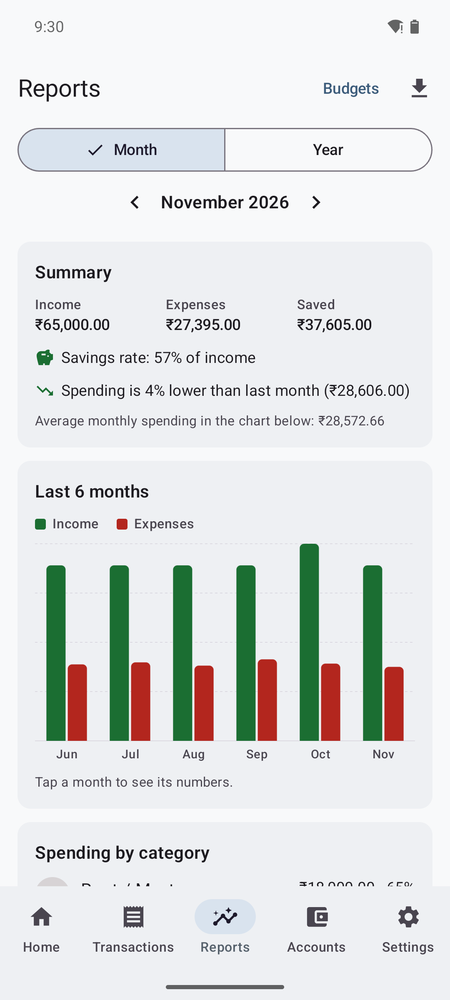

# Talenta

A free, offline-first Android app for tracking household income, expenses, transfers and account
balances, with budgets, reports, repeating transactions and shop-bill scanning into grouped expenses. It has no ads, no account and no
internet access. Bill text is read on the device.

<p>




</p>

- **User guide with screenshots (install and how to use the app):** [docs/USER_GUIDE.md](docs/USER_GUIDE.md)
- **Download the app:** [latest release](https://github.com/PintuPx/talenta/releases/latest)
- **Feature reference (what the app does, where to find it):** [docs/FEATURES.md](docs/FEATURES.md)
- **Status, pending work and limitations:** [docs/STATUS.md](docs/STATUS.md) · **Changes:** [CHANGELOG.md](CHANGELOG.md)
- **License:** [Apache-2.0](LICENSE)
- **Third-party licenses:** [THIRD_PARTY_NOTICES.md](THIRD_PARTY_NOTICES.md)
- **Architecture and database schema:** [docs/ARCHITECTURE.md](docs/ARCHITECTURE.md)
- **Accounting rules and formulas:** [docs/ACCOUNTING_RULES.md](docs/ACCOUNTING_RULES.md)
- **Applying your branding:** [docs/BRANDING.md](docs/BRANDING.md)

## Tech stack

Kotlin 2.4.21 · AGP 9.5.2 (built-in Kotlin) · Gradle 9.8.2 · Jetpack Compose (BOM 2026.11.01, Material 3) ·
Hilt 2.60.1 · Room 2.8.5 · KSP 2.3.14 · Navigation Compose 2.10.2 (type-safe routes) · DataStore 1.3.0 ·
kotlinx.serialization 1.13.0 · ML Kit Text Recognition 16.0.1 (bundled, on-device) · ExifInterface 1.4.2 ·
JUnit 4, Robolectric 4.18.1, Compose UI Test.

SDK levels:
- **minSdk 26** (Android 8.0)
- **targetSdk 36**, which Google Play has required for new apps and updates since 31 Aug 2026
- **compileSdk 37.1**, which Compose BOM 2026.11.01 requires

All versions are listed in [gradle/libs.versions.toml](gradle/libs.versions.toml).

## Requirements

- JDK 17 or newer (AGP 9.5 needs at least 17)
- Android SDK with `platforms;android-37.1`, `build-tools;36.1.0` and `platform-tools`
- Android Studio (a 2026.2.x release that supports AGP 9.5), or the command line

`local.properties` (git-ignored) must point to your SDK:

```properties
sdk.dir=C\:/path/to/Android/Sdk
```

## Build and test from the command line

```bash
./gradlew :app:assembleDebug          # debug APK  -> app/build/outputs/apk/debug/app-debug.apk
./gradlew :app:testDebugUnitTest      # JVM unit + Robolectric (Room, Compose UI) tests
./gradlew :app:lintDebug              # Android lint
./gradlew :app:connectedDebugAndroidTest   # instrumented tests (needs a device or emulator)
./gradlew :app:bundleRelease          # release AAB -> app/build/outputs/bundle/release/app-release.aab
```

On Windows, use `gradlew.bat` or run `./gradlew` from Git Bash.

The debug build uses the application ID suffix `.debug`, so it can be installed alongside a release
build.

## Release signing

Release builds are signed only when `keystore.properties` exists in the project root. That file is
git-ignored. Never commit it or the keystore.

```properties
storeFile=/absolute/path/to/upload-keystore.jks
storePassword=...
keyAlias=upload
keyPassword=...
```

To create an upload key (once, then keep it backed up safely):

```bash
keytool -genkeypair -v -keystore upload-keystore.jks -alias upload -keyalg RSA -keysize 2048 -validity 10000
```

Use **Play App Signing**: Google holds the app signing key, and this keystore is only the upload key.
Without `keystore.properties`, `bundleRelease` produces an **unsigned** AAB that Play won't accept.

## Before the first Play upload

1. ~~Set `APP_ID` and `APP_NAME`~~ Done: `com.talenta.finance` / Talenta. Bump `APP_VERSION_CODE` and
   `APP_VERSION_NAME` in `gradle.properties` for each release. The application ID can never change after
   the first upload.
2. Apply the final branding (see `docs/BRANDING.md`).
3. Create the upload key and `keystore.properties`.
4. Run the instrumented tests on an emulator or device.

## Install on a phone without Google Play

1. Download `app-release.apk` from the project's GitHub **Releases** page.
2. Open it on the phone. Android asks you to allow installs from that app (browser or Files) once.
3. Updates install over the old version and keep your data, **only if they are signed with the same key**. Back up your data first (Settings → Backup).

Building the APK yourself: create `keystore.properties` (see "Release signing"), then run `gradlew assembleRelease`. The file is `app/build/outputs/apk/release/app-release.apk`.

## License

Talenta is licensed under the [Apache License 2.0](LICENSE). Third-party libraries keep their own licenses; see [THIRD_PARTY_NOTICES.md](THIRD_PARTY_NOTICES.md). Google ML Kit text recognition is free to use but not open source.
