# Talenta user guide

Applies to version 0.2.0.

Talenta works offline and keeps your records on your phone. It starts in Individual mode. Family sharing and syncing between phones are not part of this release. Money is entered in the currency chosen in Settings.

The bottom bar has five tabs: Home, Transactions, Reports, Accounts and Settings.

The screenshots use made-up sample data and were taken before 0.2.0, so some newer controls described here are not shown in them.

## Install

1. On your phone, open the project's [Releases page](https://github.com/PintuPx/talenta/releases) and download the latest APK.
2. Open the file. If Android asks, allow your browser or file manager to install unknown apps (only for this install).
3. Open **Talenta**. It starts with a **Cash** account and a ready-made list of categories.

To update, install the new APK over the old one; your data is kept when the new APK is signed with the same key. Don't uninstall first, because uninstalling deletes the app's data. Export a backup before updating (see Settings).

## Home

Home shows your total balance, this month's income and spending, spending by category, recent transactions and your budget status. Use **Income**, **Expense** or **Transfer** to add an entry. Transfers move money between accounts and are not income or spending. **Scan bill** and **Bills** open the bill screens. At the start of a month, a card asking "Close ... now?" may appear (see Month close).

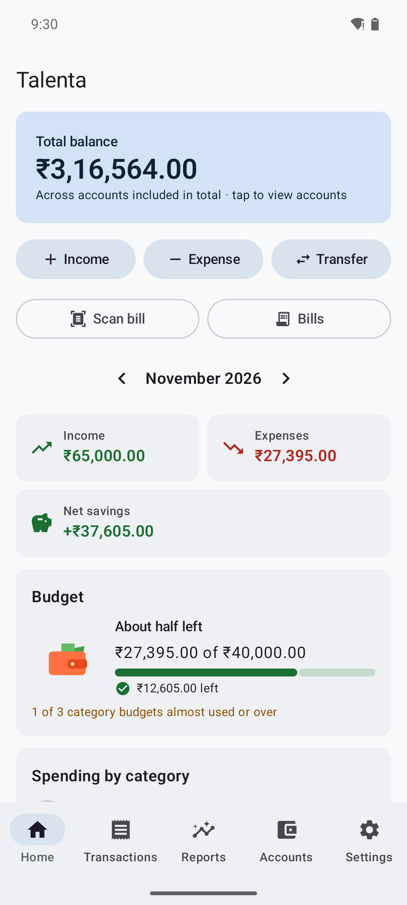

## Add or edit a transaction

Choose a type, enter the amount, account and category, then save. Turn on **This is a refund** for money returned for a purchase. Payee suggestions appear as you type. You can add a note, pick a date and time, and set it to repeat (see Repeating transactions). Open a saved transaction to edit, duplicate or delete it. After a delete, **Undo** is offered.

**For (optional)** lets you assign an entry to expense members or a tag (see Expense members and tags). **History** in the top bar of an edit screen lists the earlier versions of that entry.

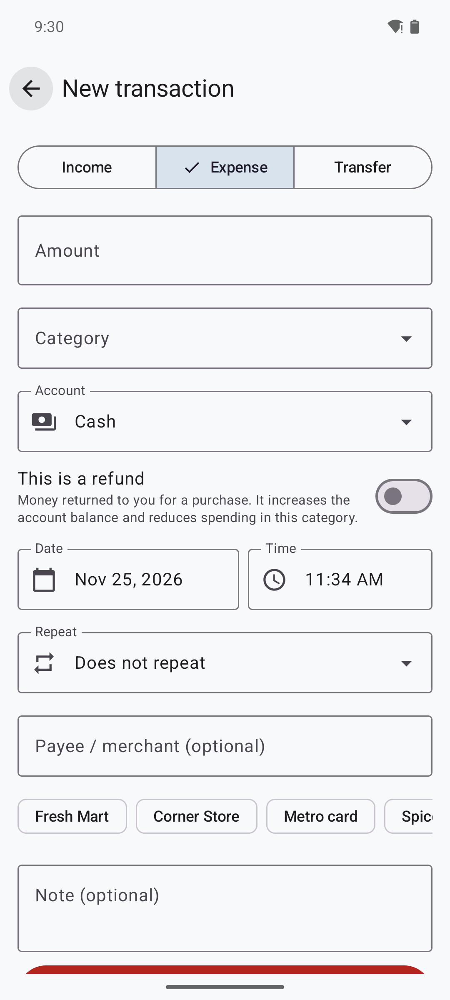

## Transactions

Search by note, payee or category. Filter by date, type, account or category, and sort by date or amount. Tap a transaction to edit it.

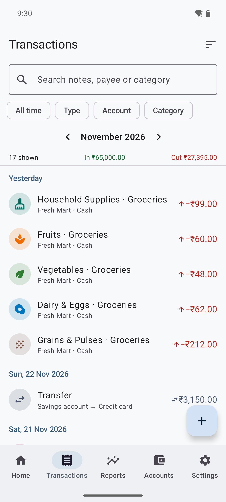

## Accounts

See each account's balance, add an account with **Add account**, or edit one with its pencil button. In the edit form, **Archived (hidden from pickers)** hides an account you no longer use; its history is kept and it is listed under **Archived**. **Delete account** works only for accounts with no records. A payment to a credit card is a transfer, not a second expense.

Investment accounts: money you add is recorded by transfer and is not spending. The account shows contributions, and **Update current value** lets you enter its current value, so the account shows a gain or loss.

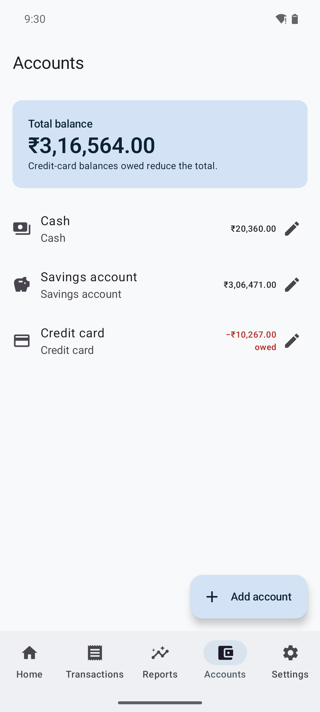

## Bills

Tap **Scan bill** on Home, then choose **Take a photo**, **Choose a photo** or **Enter manually**. Text is read on the phone; the photo is not uploaded. On the review screen, check the shop, date, total and item lines. Correct descriptions and amounts, choose groups, and exclude or add lines. Tap **Approve & add** when ready. The bill becomes expenses by group.

- **Bill text** opens the recognised lines. Pick a line to fill the shop name, or the selected item's name or amount. These are suggestions for you to check.
- If the photo seems to show a card number, PIN, OTP, CVV or card expiry, a warning suggests retaking it without that. It is a best-effort check and may miss things.
- If you change the group of an item Talenta has learned, it asks **Only this time** or **Always**. After **Always**, **Change past entries too?** can update earlier entries for that item (**Change past entries too** / **Not now**). Changes to past entries offer **Undo**.

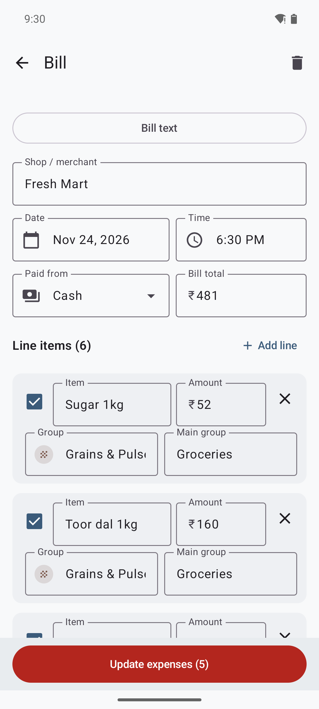
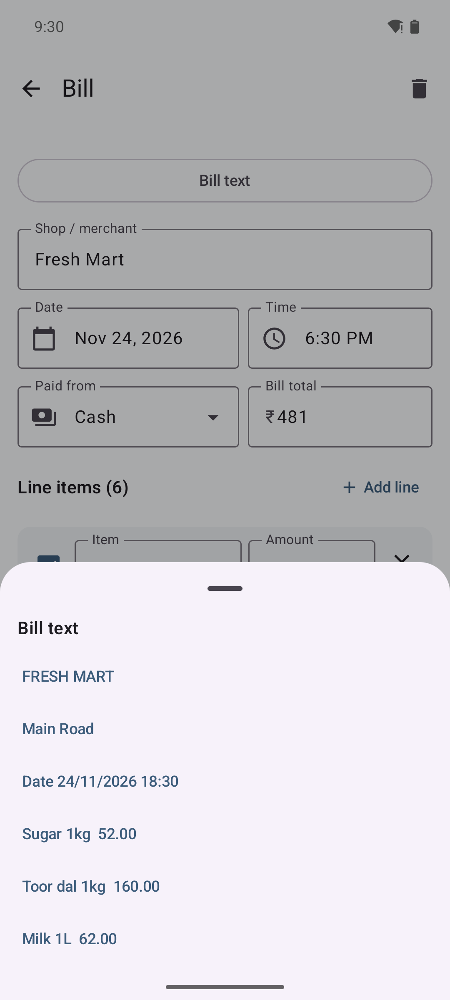

**Bills** on Home lists all your bills.

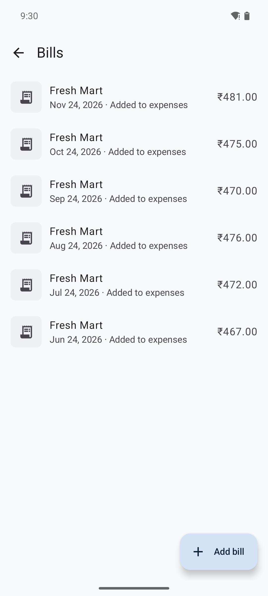

## Budgets

Open Budgets from Settings or from the button on Reports. Add a budget for **All spending** or a **Category**, with a **Monthly limit**. You can copy the previous month's limits, see **Spending without a budget**, get a warning when you near a limit, and see about how much you can spend per day for the rest of the month. When there is enough history and no overall budget, an estimate may be shown.

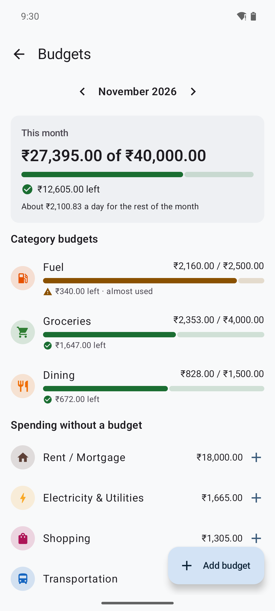

## Reports

Switch between **Month** and **Year** and move between periods. The Summary shows income, expenses and saved or overspent amounts. If you have an investment account, it also shows **Invested this month** or **Invested this year**. Charts and category breakdowns open for details; item price history comes from approved bill lines.

If you have added expense members or tags, a **Family shares** card lets you filter the report by **All transactions**, **Not assigned**, a member or a tag.

The download button at the top exports transactions as CSV, for this period or **All transactions**. CSV files are not encrypted.

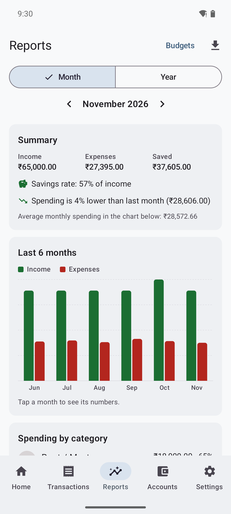
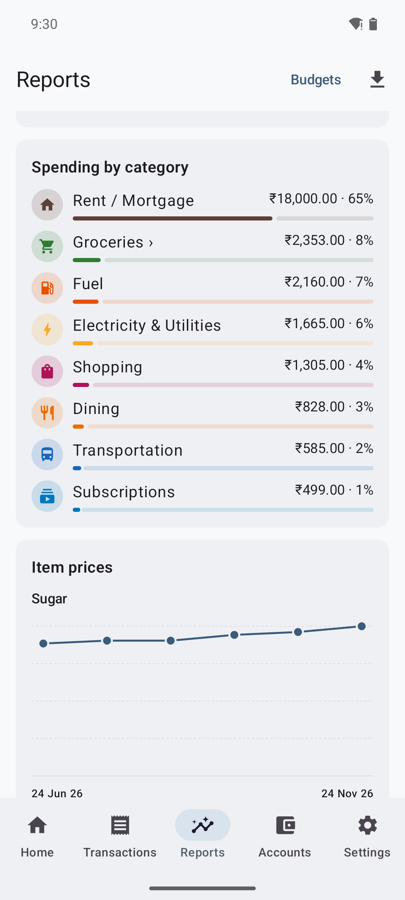

## Repeating transactions

Settings, Planning, **Repeating transactions**. Add rent, salary, subscriptions or EMIs once. Due ones are added when you open the app, and **Bills due** lists items that need you to record a payment. Amounts are fixed. Paused items are not added, and missed dates are skipped when resumed. Deleting a rule keeps transactions it already added.

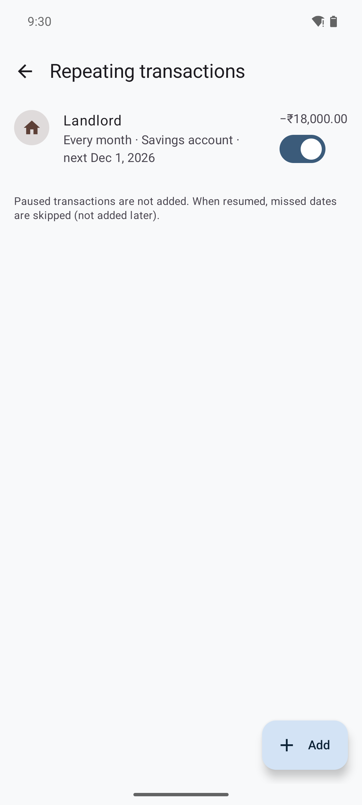

## Expense members and tags

Settings, **Expense members and tags**. Add members by name and create tags. **All** is built in and includes every active member. Removing a member keeps their share on past entries. This is for tracking who an entry is for on this phone; it does not share data with anyone.

## Month close

Settings, **Month close**, lets you close the previous month with **Close now** or **Remind me later**. Closing is optional and never automatic. A closed month shows a notice that only the Admin can edit it, and can be reopened with **Reopen month**. There is a single user in this release, so use Reopen month if you need to change a closed month.

## History

Settings, **History** shows saved changes to entries. It is titled "Household history" on screen and has **Filter by member**, **Filter by entry** and **Filter by date**. Each entry's own history is under **History** on its edit screen.

## Private mode

Settings, **Private mode** switch.

- When on, only private data is shown, a banner appears at the top (tap **Turn off** to end it), and screenshots and screen recording are blocked.
- It turns off by itself when the app goes to the background.
- **Ask for device lock** (on by default) asks for your fingerprint or phone PIN when you turn Private mode on. If your phone has no screen lock, you can continue without confirmation.
- This is a view filter plus a confirmation step. It does not encrypt your data.
- Known limitation: on Android 9 and 10, with **Ask for device lock** on, Private mode cannot be turned on and shows "Device authentication is unavailable."

## Wallet icon and widget

The launcher icon and the home-screen widget show a wallet that reflects how much of this month's budget is left. They refresh when you leave the app.

## Settings

| Area | What is there |
|---|---|
| General | **Currency**, **Theme**, **Categories**, **Private mode**, **Ask for device lock**, **Expense members and tags** |
| Planning | **Budgets**, **Repeating transactions**, **Month close** |
| Backup & restore | **Export backup**, **Restore from backup** |
| Privacy & about | **Privacy**, **History**, **Version**, **Report a bug** (opens the project's GitHub issues page in your browser) |
| Danger zone | **Clear all data** |

**Backups are plain JSON and are not encrypted.** Anyone who can open the file can read your records. Store it privately. Bill photos are not included. **Restore from backup** replaces all current data on the phone. **Clear all data** cannot be undone.

**Backups and app versions.** A backup restores in the same version of Talenta or any newer one, including backups from older versions. A backup made by a newer version cannot be restored in an older one: the app shows "This backup was created by a newer version of the app. Please update the app first." and leaves your current data unchanged. Update Talenta, then restore again. CSV exports open in any spreadsheet, whatever the version.

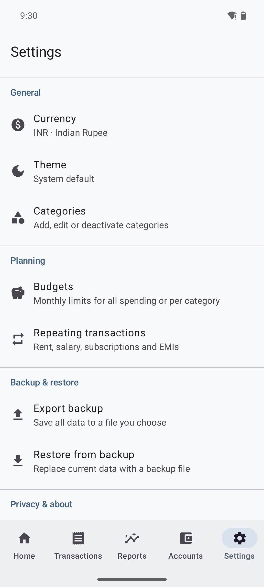

## Privacy

- **No internet:** the app has no network permission, so it cannot send anything anywhere.
- **No ads, analytics or tracking**, and no account to create.
- **Android cloud backup is turned off**, so your records are not copied off the phone without your action.
- If the app crashes, it saves a **private crash report on the phone**, with no amounts, notes or other data you entered. You decide whether to share it.

More detail: [privacy policy](privacy-policy.md).

## Help

- **Something wrong?** Use **Settings → Privacy & about → Report a bug**, or open an issue on the [GitHub issues page](https://github.com/PintuPx/talenta/issues). Please never post your financial data.
- **Every feature and where to find it:** [FEATURES.md](FEATURES.md).
- **How totals are calculated** (transfers, refunds, budgets): [ACCOUNTING_RULES.md](ACCOUNTING_RULES.md).
